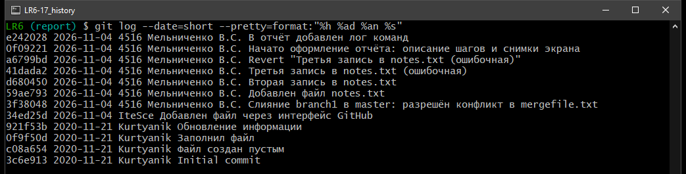

# Лабораторная работа №6. Система контроля версий

**Студент:** Мельниченко В.С., группа 4516

**Цель работы:** изучение базовых возможностей системы управления версиями, опыт работы с Git API, опыт работы с локальным и удалённым репозиторием.

## Ход работы

### 1-3. Аккаунт, форк, установка Git

Использован аккаунт GitHub `IteSce`. Создан форк `Kurtyanik/LR6`, установлен Git 2.56.

В форк попала только ветка `master`, поэтому ветка `branch1` получена из исходного репозитория через удалённый репозиторий `upstream`.

### 4. Настройка клиента git


### 5. Клонирование личного удалённого репозитория


### 6. Добавление файла через интерфейс GitHub и получение изменений


### 7. История операций для каждой из веток


### 8. Последние изменения


### 9. Слияние в master с разрешением конфликта

Файл `mergefile.txt` изменён в обеих ветках, поэтому при слиянии возник конфликт.


В итоговый файл вошли строки из обеих веток.


Результат слияния в графическом интерфейсе gitk:


### 10. Удаление побочной ветки


### 11. Изменения и фиксации с комментариями


### 12. Откат коммита

Ошибочная третья запись отменена командой `git revert`.


### 13. Ветка для отчёта


## Лог команд

Шаг 6 выполнен через веб-интерфейс GitHub, поэтому команд не содержит.

**Шаг 4. Настройка клиента git**

```bash
git config --global user.name "4516 Мельниченко В.С."
git config --global user.email "187447345+IteSce@users.noreply.github.com"
git config --global user.name
git config --global user.email
```

**Шаг 5. Клонирование**

```bash
git clone https://github.com/IteSce/LR6.git
cd LR6
git remote -v
git branch -a
ls
```

**Шаг 5. Ветка branch1 из исходного репозитория**

```bash
git remote add upstream https://github.com/Kurtyanik/LR6.git
git fetch upstream
git branch branch1 upstream/branch1
git branch -a
```

**Шаг 6. Получение файла, добавленного через GitHub**

```bash
git pull
ls
git log --oneline -3
```

**Шаг 7. История операций для каждой из веток**

```bash
git log master --date=short --format='%h %ad %an %s'
git log branch1 --date=short --format='%h %ad %an %s'
git log --all --graph --oneline
```

**Шаг 8. Последние изменения**

```bash
git log -p -1 master
git log -p -1 branch1 -- mergefile.txt
git diff master branch1 --stat
```

**Шаг 9. Слияние в master, конфликт**

```bash
git checkout master
git merge branch1
git status
cat mergefile.txt
```

**Шаг 9. Разрешение конфликта**

```bash
printf 'Файл\nзаполнен\nочень\nважной\nинформацией\nпротиворечащей\nветке\nmaster\n' > mergefile.txt
cat mergefile.txt
git add mergefile.txt
git commit -m "Слияние branch1 в master: разрешён конфликт в mergefile.txt"
git status
git log --graph --oneline -6
```

**Шаг 10. Удаление побочной ветки**

```bash
git branch -d branch1
git branch -a
```

**Шаг 11. Изменения и фиксации**

```bash
echo "Первая запись журнала" > notes.txt
git add notes.txt
git commit -m "Добавлен файл notes.txt"
echo "Вторая запись журнала" >> notes.txt
git commit -am "Вторая запись в notes.txt"
echo "Ошибочная запись" >> notes.txt
git commit -am "Третья запись в notes.txt (ошибочная)"
git log --oneline -3
```

**Шаг 12. Откат коммита**

```bash
git revert --no-edit HEAD
cat notes.txt
git log --oneline -4
```

**Шаг 13. Ветка для отчёта**

```bash
git checkout -b report
git branch -a
```

**Шаг 14. Оформление отчёта**

```bash
git add README.md screenshots
git commit -m "Начато оформление отчёта: описание шагов и снимки экрана"
git add README.md
git commit -m "В отчёт добавлен лог команд"
git log --oneline -3
```

**Шаг 15. История операций и финальная фиксация**

```bash
git log --date=short --pretty=format:"%h %ad %an %s"
git add README.md screenshots
git commit -m "В отчёт добавлена история операций, финальная фиксация"
git status
```

**Шаг 16. Отправка в GitHub**

```bash
git push origin master
git push -u origin report
git log --all --graph --oneline -5
```

## История операций

Сокращённый хэш, дата, имя автора, комментарий. Финальная фиксация, содержащая этот раздел, в историю ещё не входит.



```
e242028 2026-11-04 4516 Мельниченко В.С. В отчёт добавлен лог команд
0f09221 2026-11-04 4516 Мельниченко В.С. Начато оформление отчёта: описание шагов и снимки экрана
a6799bd 2026-11-04 4516 Мельниченко В.С. Revert "Третья запись в notes.txt (ошибочная)"
41dada2 2026-11-04 4516 Мельниченко В.С. Третья запись в notes.txt (ошибочная)
d680450 2026-11-04 4516 Мельниченко В.С. Вторая запись в notes.txt
59ae793 2026-11-04 4516 Мельниченко В.С. Добавлен файл notes.txt
3f38048 2026-11-04 4516 Мельниченко В.С. Слияние branch1 в master: разрешён конфликт в mergefile.txt
34ed25d 2026-11-04 IteSce Добавлен файл через интерфейс GitHub
921f53b 2020-11-21 Kurtyanik Обновление информации
0f9f50d 2020-11-21 Kurtyanik Заполнил файл
c08a654 2020-11-21 Kurtyanik Файл создан пустым
3c6e913 2020-11-21 Kurtyanik Initial commit
```
