# Лабораторная работа №6. Система контроля версий

**Студент:** Мельниченко В.С., группа 4516

**Цель работы:** изучение базовых возможностей системы управления версиями, опыт работы с Git API, опыт работы с локальным и удалённым репозиторием.

## Ход работы

### 1-3. Аккаунт, форк, установка Git

Использован аккаунт GitHub `IteSce`. Создан форк `Kurtyanik/LR6`, установлен Git 2.56.

В форк попала только ветка `master`, поэтому ветка `branch1` получена из исходного репозитория через удалённый репозиторий `upstream`.

### 4. Настройка клиента git

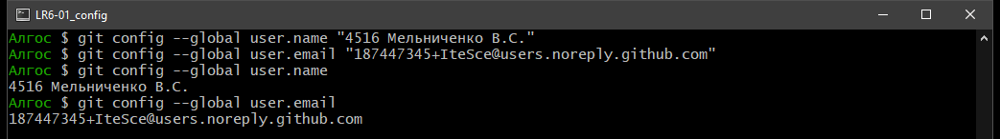

### 5. Клонирование личного удалённого репозитория

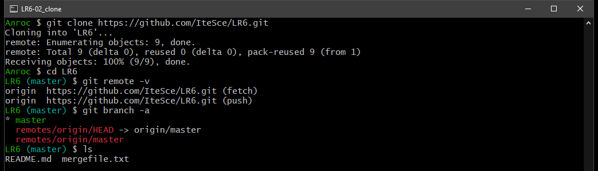

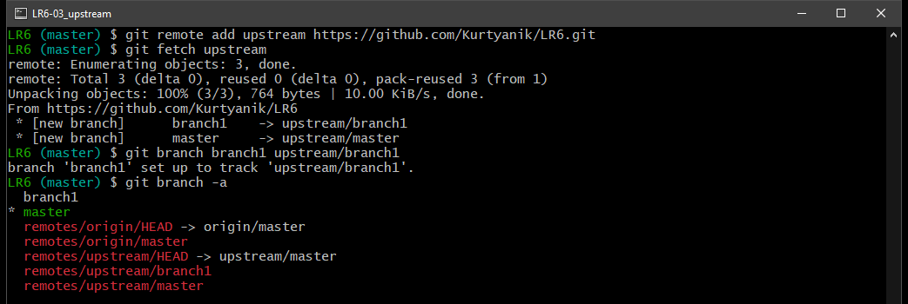

### 6. Добавление файла через интерфейс GitHub и получение изменений

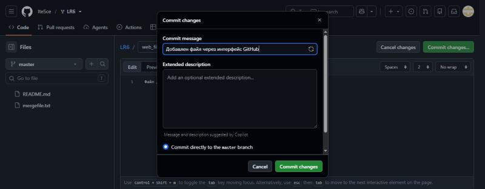

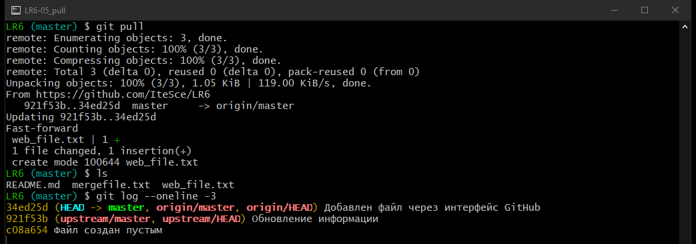

### 7. История операций для каждой из веток

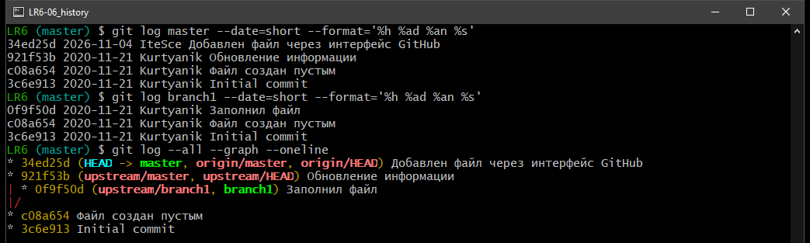

### 8. Последние изменения

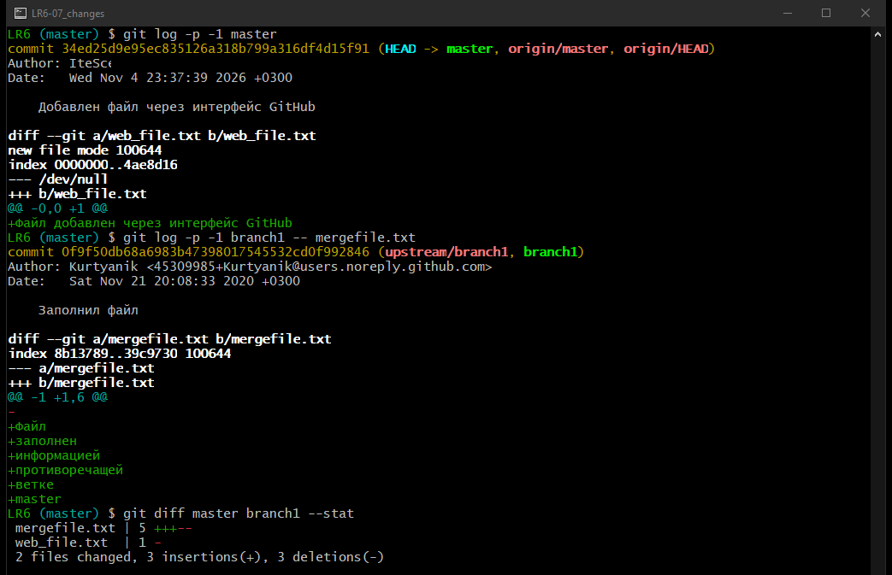

### 9. Слияние в master с разрешением конфликта

Файл `mergefile.txt` изменён в обеих ветках, поэтому при слиянии возник конфликт.

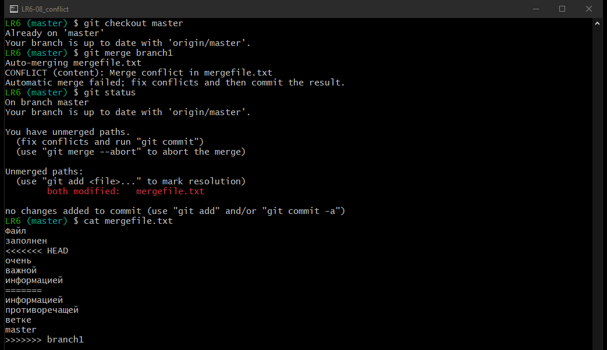

В итоговый файл вошли строки из обеих веток.

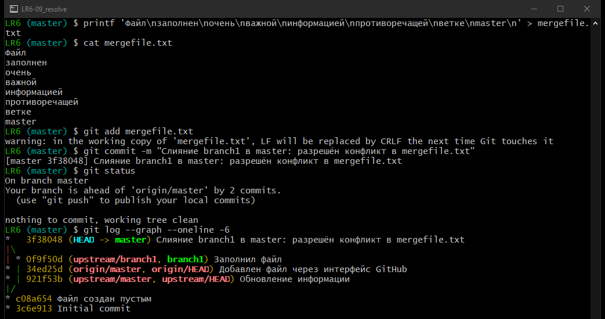

Результат слияния в графическом интерфейсе gitk:

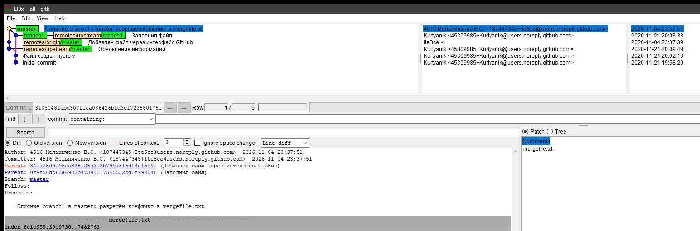

### 10. Удаление побочной ветки

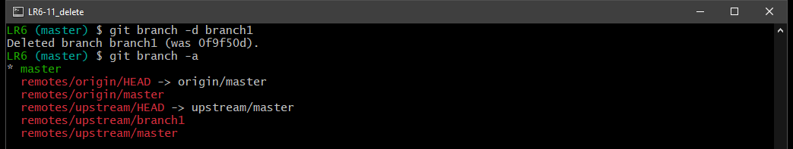

### 11. Изменения и фиксации с комментариями

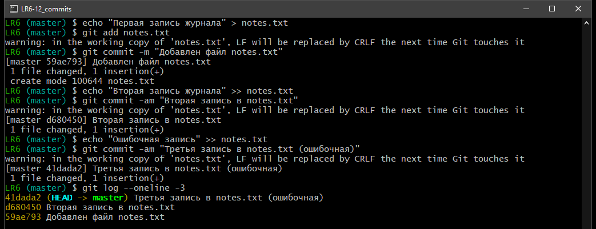

### 12. Откат коммита

Ошибочная третья запись отменена командой `git revert`.

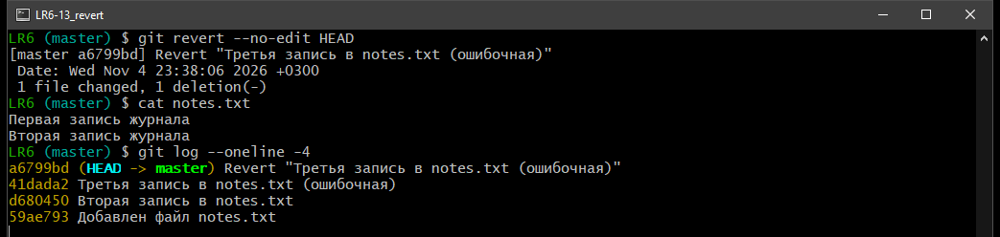

### 13. Ветка для отчёта

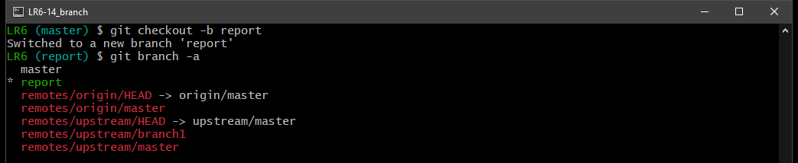
